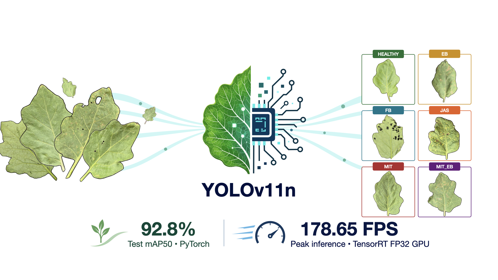

  

# Eggplant Leaf Detection with YOLOv11n

This study combines image augmentation and structured channel pruning to develop a lightweight YOLOv11n framework for detecting whole eggplant leaves and classifying healthy and pest-affected conditions.

This repository contains the article's supplementary analysis code:

- **[Supplementary File 1.ipynb](Supplementary%20File%201.ipynb)** — YOLOv11n training and test-set evaluation on the original and augmented eggplant leaf datasets.
- **[Supplementary File 2.ipynb](Supplementary%20File%202.ipynb)** — Structured channel pruning, 20-epoch recovery training and four-stage comparisons of accuracy, model complexity and inference speed across PyTorch, ONNX and TensorRT formats.

Use the study's prepared datasets and trained checkpoints as inputs, and adjust the dataset and checkpoint paths before running. Open the notebooks in Jupyter and run the cells in order. Set the desired pruning ratio in Supplementary File 2. GPU benchmarking requires a compatible NVIDIA GPU and the corresponding inference runtimes.
